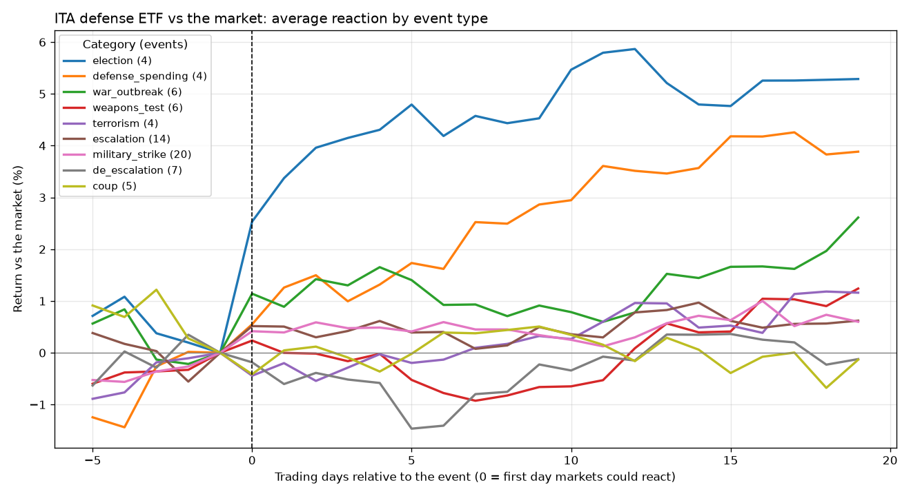
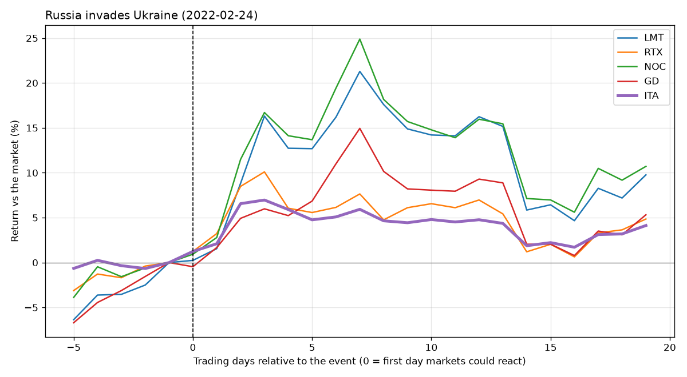

# Defense Stock Event Tracker

How do defense stocks react to geopolitical events, and can past reactions tell us anything about the next one?

This project measures how defense stocks moved against their own market around 71 geopolitical events from 2015 to 2025:

- **US:** Lockheed Martin, RTX, Northrop Grumman, General Dynamics and the ITA defense ETF, vs the S&P 500.
- **Europe:** Rheinmetall, BAE Systems, Thales, Saab, Leonardo and an equal-weighted basket of the five (EUDEF), in euros, vs the STOXX Europe 600. An **analog engine** takes a new event, finds the most similar past events, and writes a thesis from how the stocks reacted then. A **backtest** checks whether the engine is actually any good.

It also runs on its own. A **live pipeline** reads 14 news sources every hour and detects new geopolitical events. For each one it makes a prediction for every stock, locks the prediction in, and scores it once 20 trading days have passed, building a live track record nobody can quietly revise.

It comes with a React dashboard backed by a Python API.



## What it found

- **Spending announcements and elections move defense stocks the most.** Over 20 trading days, ITA beat the market by an average of +5.3% after elections and +3.9% after defense-spending announcements (4 events each).
- **War outbreaks help, and individual strikes barely register.** Outbreaks averaged +2.6%; one-off military strikes and escalations about +0.6%.
- **De-escalation holds defense stocks back.** Ceasefires and summits were the only category to lag the market (−0.1%, beating it in only 29% of cases).
- **European defense stocks react two to four times as strongly.** After defense-spending announcements, the European basket beat its market by +16.7% over 20 days (vs +3.9% for ITA). After war outbreaks it was +8.7% (vs +2.6%). Seven trading days after Russia invaded Ukraine, Rheinmetall was up 69% vs the European market.
- **Individual stocks swing far more than the sector.** After Russia invaded Ukraine, NOC and LMT were up about 25% and 21% vs the market within 7 trading days, while the ETF moved about 6%.



## Does the analog engine work?

Each event was hidden in turn and predicted from the others:

| | ITA hit rate |
|---|---|
| Analog engine (leave one out) | **67%** |
| Analog engine (only earlier events) | 61% |
| Baseline: "defense always beats the market" | 62% |
| Baseline: same-category average | 64% |

**Bottom line: the engine roughly matches a simple "defense beats the market" guess.** It's modestly better on ITA and NOC, and no better on LMT, RTX or GD. It's the same story in Europe: the EUDEF basket scores 67% vs a 64% baseline (58% vs 61% using only earlier events). With about 70 events, differences of a few points are noise.

Other things the backtest showed:
- The **first similarity weights were a coin flip** (54% on ITA). Tuning showed severity matters most, and that US involvement and surprise added nothing. The tuned weights also improved NOC, which they weren't tuned on.
- The old **high/medium/low confidence label didn't predict accuracy.** "High confidence" calls were right *less* often than "low" ones. It was removed, and the dashboard now shows the real backtested hit rate instead.
- **Confounding is everywhere.** 48 of 71 events had earnings, another event, or a 3%+ market day inside their 20-day window. The dashboard flags these on every event.

This is a research and learning project. **Nothing here is investment advice.**

## How it works

1. **Prices:** daily closes since 2015 from Yahoo Finance (`yfinance`). Each market is kept on its own trading calendar, with its own benchmark: SPY for the US, the iShares STOXX Europe 600 fund (EXSA.DE) for Europe. BAE and Saab are converted to euros with daily exchange rates.
2. **Events:** a hand-built database (`data/events.csv`) tagged by category, region, US involvement, severity, surprise, and whether the news broke after the US market close.
3. **Event study:** for each event, find the first trading day markets could react. Measure each stock's return minus SPY's (the *abnormal return*) over 1, 5 and 20 trading days.
4. **Confound checks:** flag events whose window contains company earnings, another event, or market turmoil.
5. **Analog engine:** score every past event's similarity to a new one, take the closest 8, and summarize how the stocks reacted.
6. **Backtest:** leave-one-out and past-only predictions, scored against simple baselines.
7. **Optional Claude features:** turn a news headline into tags, and write a fuller thesis from the numbers. These need an Anthropic API key.

### The live pipeline

```
news feeds ─► store new articles ─► group by story ─► classify ─► new event? ─► predict (locked) ─► score after 20 days
(news.py)        (data/news.db)      (detect.py)    (classify.py      merge with        (predict.py)
                                                     or Claude)    recent coverage
```

- **Sources:** BBC World, Al Jazeera, Guardian World, NPR World, Defense News, 8 targeted Google News searches, and GDELT.
- **What counts as an event:** a story covered by at least 3 articles from 3 different outlets. Coverage of the same story over the next 5 days is merged into it rather than counted again.
- **Classification:** with an `ANTHROPIC_API_KEY`, Claude tags each story and decides whether it's genuinely new and market-relevant. Without one, keyword rules do it. They're free, but noisier: expect some false positives, which you can dismiss in the dashboard.
- **Timing:** each event's reaction day comes from the earliest article's time in New York, so news that breaks after the 4pm close counts from the next trading day.
- **Running it:** the API server runs the pipeline every hour in the background (`AUTO_PIPELINE`, `PIPELINE_EVERY_MINUTES` in `.env`). To run it without the dashboard: `python pipeline.py` (once) or `python pipeline.py --loop 60`. Market data refreshes at most every 12 hours. `python refresh.py` refreshes it on demand.

## Running it

Requires Python 3.13+ and Node.js 20+.

```bash
# Python side
python -m venv .venv
.\.venv\Scripts\python.exe -m pip install -r requirements.txt

# Build all the data (prices, earnings, reactions, charts) in one go
.\.venv\Scripts\python.exe refresh.py

# Start the API, which also starts the hourly news pipeline
# (http://localhost:8000/docs lists every endpoint)
.\.venv\Scripts\python.exe -m uvicorn api:app --reload
```

In a second terminal:

```bash
cd frontend
npm install
npm run dev
```

Then open http://localhost:5173.

**Optional Claude features:** copy `.env.example` to `.env` and add your `ANTHROPIC_API_KEY`. Without it, everything else still works.

## Project layout

| File | What it does |
|---|---|
| `data/events.csv` | The event database, edited by hand. Run `check_events.py` after editing. |
| `refresh.py` | One command to re-download and recalculate all market data |
| `download_prices.py`, `download_earnings.py` | Fetch market data |
| `pipeline.py` | The live loop: news → events → predictions → scores |
| `news.py` | Fetch RSS feeds and GDELT into `data/news.db` |
| `detect.py`, `classify.py` | Group headlines into stories and tag them as events |
| `predict.py` | Locked-in live predictions and later scoring |
| `calculate_reactions.py` | The event study: abnormal returns per event and stock |
| `confounds.py` | Earnings, overlapping-event and market-turmoil checks |
| `find_analogs.py` | The analog engine and template thesis (also a command-line tool) |
| `backtest.py` | Scores the engine; `--tune` searches for better weights |
| `make_charts.py` | Static PNG charts |
| `api.py` | FastAPI back end for the dashboard |
| `ai.py` | Optional Claude features |
| `frontend/` | React + Recharts dashboard |

## Limitations

- **Small sample:** 71 events, some categories with only 4. No African events yet.
- **Tags are judgment calls,** especially severity and surprise.
- **Live detection without Claude is noisy.** The keyword rules catch the big stories, but also let through things like company weapons tests or human-interest pieces that mention a war.
- **The live pipeline only runs while the API server is running** on your computer.
- **Event timing is US-based.** The `after_close` flag refers to the 4pm New York close. European markets close at 11:30 New York time, so for news that broke during US hours, Europe may really react a day later than measured.
- **European defense stocks have trended up hard since 2022,** so "beat the market" is partly that trend, not the event.
- **BAE and Thales have no earnings dates** in the Yahoo data, so earnings confounds are missed for those two.
- **Market-adjusted returns only:** stock return minus SPY. A fuller model would adjust for each stock's sensitivity to the market (beta).
